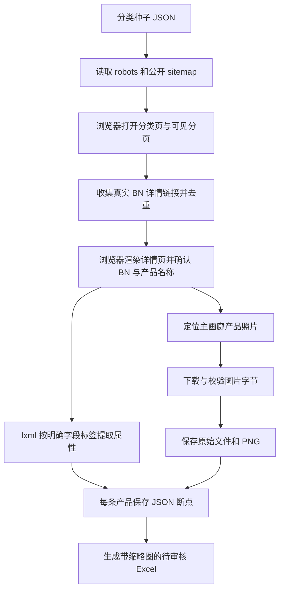

# Bossard 本地采集工具：配置与原理

工具包版本：2.0.1，更新日期：2026-11-12。此版本号属于独立采集工具，不是网页服务版本。

本工具将 Bossard 中国站的公开 **BN 产品系列**、属性和主产品照片保存到你自己的电脑，再生成待审核 Excel。它不自动写入网站业务数据库。本次新增的“产品图片”就是产品详情页大画廊中展示的实物照片；工程尺寸图不作为产品照片。

2.0.1 修复了缺少 Playwright 或浏览器启动失败时，只导出缓存却返回0的问题。现在会显示失败阶段、具体异常、当前 Python 对应的安装命令，并返回1；结束时会分别显示本次新下载、本地已有和待补采图片数量。

已经下载2.0工具包的用户，可在交付目录只下载 `Bossard_collector_fix_2.0.1.zip` 覆盖程序文件。修复包不含 `cache`、`settings.bat`、`collector_config.json`、已生成的 Excel，不会替换你的已有数据或配置。

## 1. 先下载和解压

从仓库 [交付目录](review_exports/bossard/2026-11-11/README.md) 下载 `Bossard_collector_with_product_images.zip`。打开 GitHub 文件页后点击 **Download raw file**；也可以 `git pull` 后到该目录取文件。不依赖聊天右侧 Workspace 的下载按钮。

将 ZIP **完整解压**到可写目录，例如 `D:\BossardCollector`。不要在压缩包预览窗口内直接运行，不要只取一个 Python 文件。主要内容：

```text
BossardCollector/
├─ 01_install.bat                 # Windows：安装依赖和 Chromium
├─ 02_resume_with_images.bat      # 继续采集新产品，并给已有产品补主图
├─ 03_images_only.bat             # 仅给已有缓存产品补主图
├─ 04_export_offline.bat          # 不联网，按当前缓存重新生成 Excel
├─ settings.bat                  # 设置运行工具的 Python 路径
├─ collector_config.json         # 采集参数；通常只需修改这里
├─ run_bossard_collector.py       # 配置入口，生成时间戳文件名并调用采集器
├─ bossard_catalog.py            # 页面发现、解析、断点、报告、Excel 导出
├─ bossard_images.py             # 主图定位、图片校验与保存、Excel 缩略图
├─ collector_requirements.txt    # 此工具独立依赖
├─ BOSSARD_COLLECTOR_GUIDE.md     # 本文：怎么运行、参数怎么改、为什么这样做
├─ BOSSARD_COLLECTOR_API.md       # 命令行、Python 函数与数据接口定义
├─ categories.json              # 分类种子；包内已准备
├─ cache/
│  ├─ category-checkpoint.json   # 分类、已发现产品链接与未处理队列
│  ├─ discovered-products.json   # 已发现产品链接
│  ├─ <来源URL的SHA256>.json     # 每个已成功产品一份 JSON
│  ├─ export-data.json           # 最近一次汇总数据，供离线导出
│  ├─ crawl-report.json          # 最近一次采集报告
│  └─ images/
│     ├─ BN2.source.webp        # 下载得到的原始响应文件，扩展名按真实格式确定
│     └─ BN2.png                # 同一张图片的 PNG 副本，便于本地查看
└─ output/                      # 每次运行生成的新 Excel，目录会自动创建
```

包内沿用上一轮 **39 个分类、391 个已解析 BN、317 个待续采 BN** 的快照。新增图片能力已经用 BN2 实际验证，包内含这一张示例主图；其余390个已解析产品的图片需要你在本地补采，不能把“已有属性”当成“图片已齐”。新增317个产品也仍需继续采集详情。

## 2. 本地需要准备什么

需要 Windows、Python 3.10 及以上（推荐3.11），以及能正常访问 `https://www.bossard.com.cn` 的网络。安装依赖时还需要访问 Python 包源和 Playwright 浏览器下载源。电脑上需要足够的图片保存空间和缓存目录写权限。

**不需要**配置 DeepSeek API Key、DINO 权重、MySQL，也不需要先启动资料库网页。这是单独运行的采集工具，不涉及模型推理。

你之前提供的 Anaconda 路径可先检查版本：

```bat
"C:\ProgramData\anaconda3\python.exe" --version
```

版本合适时，将 `settings.bat` 的最后一行改为：

```bat
set "COLLECTOR_PYTHON=C:\ProgramData\anaconda3\python.exe"
```

若已有独立环境，就改为该环境的 `python.exe` 完整路径。不要把工程目录、`Scripts` 文件夹或 `activate.bat` 当作 Python 路径。建议用独立 Python 环境安装采集依赖，避免改动现有模型工程环境。

双击 `01_install.bat`。它只执行安装，不开始采集。也可以打开命令行，在解压目录执行：

```bat
"C:\ProgramData\anaconda3\python.exe" -m pip install -r collector_requirements.txt
"C:\ProgramData\anaconda3\python.exe" -m playwright install chromium
```

后文用 `python` 简写；若命令行找不到 Python，请替换为上面的完整路径。必须用**同一个 Python 环境**安装依赖并运行脚本。

## 3. 最推荐的第一次操作

先在浏览器中手动打开一条 Bossard 产品来源链接，确认不是访问受限页面。关闭 Excel 中已经打开的输出文件，然后：

1. 双击 `03_images_only.bat`，先给缓存中的391个产品补照片。这种模式不会继续采集另外317个产品详情。
2. 运行过程中看到“补采主图 BNxxx”属于正常进度。它是串行低速运行，数百个产品需要时间，不要同时开多个窗口共用同一个缓存。
3. 结束后打开 `output` 中最新的 Excel，在“产品审核”右侧查看“产品图片”“图片本地路径”“图片来源URL”“图片状态”“图片说明”。
4. 在“采集报告”检查实际下载数、待补图 BN 和失败原因。图片保存到 `cache/images`；Excel 只嵌入较小的缩略图。
5. 需要继续采集尚未成功的产品时，再双击 `02_resume_with_images.bat`。它沿用同一份缓存。

每次生成新的时间戳文件，例如 `Bossard_images-only_20261112_153000_123456.xlsx`，不会覆盖已经人工审核的表。时间使用本地电脑时区。

如果只想重新生成表格，双击 `04_export_offline.bat`，它不会请求源站。它读取最近一次 `cache/export-data.json`，并将 `cache/images` 中的图片重新嵌入 Excel。

## 4. 哪些参数需要配置

打开 `collector_config.json`，这是标准 JSON，不能写 `//` 注释，Windows 路径中的反斜杠要写成 `\\`，也可以用 `/`。

```json
{
  "categories": "categories.json",
  "cache": "cache",
  "output_dir": "output",
  "delay": 3.0,
  "max_products": 0,
  "max_category_pages": 1000,
  "max_sitemap_pages": 200,
  "browser_executable": "",
  "download_images": true,
  "embed_images": true
}
```

| 配置项 | 包内默认值 | 什么时候修改 |
| --- | --- | --- |
| `categories` | `categories.json` | 分类种子文件位置。包内已准备，通常不改 |
| `cache` | `cache` | 保存断点、产品JSON和图片的目录。续采必须用原目录；换空目录等于重新开始 |
| `output_dir` | `output` | Excel 输出目录，可以改为 `D:/BossardResults` |
| `delay` | `3.0` | 页面导航、显式图片下载和 sitemap 请求之间的间隔秒数。最低1秒，站点 robots 要求更慢时自动采用更慢值 |
| `max_products` | `0` | 0=不主动限制产品数。包括已经恢复的缓存产品，不是“额外新增多少个”；设5时可能仅处理已有缓存中的5条 |
| `max_category_pages` | `1000` | 每轮分类页面状态的上限，包括可见翻页。达到后保留待处理项，并不代表完成 |
| `max_sitemap_pages` | `200` | 每轮 sitemap 读取上限，达到后保留队列 |
| `browser_executable` | `""` | 留空时寻找系统 Chromium/Chrome/Edge，找不到再用 Playwright 安装的 Chromium。可填 `C:/Program Files/Google/Chrome/Application/chrome.exe` |
| `download_images` | `true` | 设 `false` 只采属性，不显式保存图片；“只补图”模式要求为 `true` |
| `embed_images` | `true` | 设 `false` 时仍保存本地图片，但 Excel 不嵌缩略图，适合数据多或要减小表格体积 |

相对路径都以**配置文件所在目录**为基准，不依赖你从哪个目录打开命令行。建议先只设置 `settings.bat` 的 Python 路径，其他默认值可直接运行。未知配置名、字符串形式的 `"true"`、负数上限等会在开始前报错。

若用公司代理，在本机命令行按公司提供的地址设置 `HTTPS_PROXY`，Python 请求和采集浏览器会读取它；无需代理时不用配置。不要关闭证书校验或改脚本来绕过站点限制。

## 5. 三种运行方式与直接命令

配置入口适合日常使用：

```bat
python run_bossard_collector.py --mode images-only
python run_bossard_collector.py --mode resume
python run_bossard_collector.py --mode export
```

需要另用一份配置：

```bat
python run_bossard_collector.py --config D:/BossardCollector/collector_config.json --mode images-only
```

下面是绕过配置入口、直接调用核心采集脚本的等价示例，便于学习每个参数的用途。**直接 CLI 的相对路径以当前命令行目录为准**，输出文件名需要自己指定。

```bat
python bossard_catalog.py --categories categories.json --crawl --images-only --cache cache --delay 3 --output 本地补图审核.xlsx
```

继续采集属性和主图：

```bat
python bossard_catalog.py --categories categories.json --crawl --cache cache --delay 3 --output 续采审核.xlsx
```

离线重新导出：

```bat
python bossard_catalog.py --categories categories.json --products cache/export-data.json --image-root cache --output 重新导出审核.xlsx
```

不嵌缩略图以减小 Excel：在上面的命令末尾加 `--no-embed-images`。只采属性：采集命令加 `--skip-images`。不必改代码。

`--refresh` 会重新读取产品属性页，不能和 `--images-only` 同用；只缺图片时不需要刷新全部属性。`--overwrite` 允许覆盖指定输出，但不要用于已人工审核的工作簿。完整 CLI 定义见 [接口文档](BOSSARD_COLLECTOR_API.md)。

## 6. 它采用了什么采集思路

核心思路是：**先发现真实链接，再读取页面上明确的信息，每一步留下来源和断点，最后由人审核**。不是遍历猜测 BN 编号，也不是用截图或 AI 猜产品属性。



### 为什么用浏览器和 HTML 解析两种工具

部分产品列表、分页和图片信息由网页脚本动态生成。Playwright 负责像正常浏览器一样打开页面、等待渲染、点击可见的“下一页/加载更多”。lxml 负责读取渲染后的 HTML，把“材质→钢”这样的标签和值整理成字段。

二者职责不同：浏览器解决“内容有没有出现”，解析器解决“出现的内容怎样变成结构化数据”。图片文件本身再用 Python HTTP 客户端下载，不截整页，也不把截图中的红框坐标写死。

### 怎么确保拿到你框出的产品照片

产品详情主画廊的图片带有 `data-testid="product-gallery-image"`。脚本优先取这个明确标记，而不是网页里的第一张图片；同一元素的 `srcset` 提供多个尺寸时，选择其中最大的实际地址。

主图缺失时，仅检查标为 `product-gallery-image-thumbnail` 且明确是产品照片的画廊缩略图。包含“技术图/工程图”、`_zv_` 等标记的图片会排除。网站标志、占位图和推荐商品图片不会拿来补空缺。页面没有可靠照片时记录 `not_found`，保留缺失说明。

下载的是网页提供的媒体 URL。路径中的 `&w=760&h=570` 等参数原样保留；脚本不自行拼接“无限高清”地址。这里的 `.source.webp` 意思是**所选URL实际返回的原始字节**，不代表拿到了供应商后台的最高分辨率素材。

### 为什么保留三类文件

- 每条产品 JSON：保留名称、原始属性、分类线索、主图 URL、下载状态与文件路径，便于复查和续采。
- 图片原始文件与 PNG：原始字节便于核对，PNG 方便常见看图软件打开。SHA-256 可检查原始文件是否被修改。
- Excel：给人工审核使用。缩略图最大140×105像素，避免把每张大图都塞进表格；清晰原文件仍在缓存目录中。

这些路径是相对缓存目录的，搬家时复制**整个工具目录或整个 cache**，不能只拷走 Excel 后期待本地路径仍能找到原图。已嵌入 Excel 的缩略图可独立查看。

### 如何断点续采

详情 URL 经过 SHA-256 得到对应 JSON 文件名；同一产品链接再次运行时会找到缓存。主图 PNG 已存在时跳过，文件丢失或未下载时补采。旧缓存没有主图 URL 时，会重新打开它的来源详情页，确认 BN 后提取主图。

每次保存先写临时文件再替换，减少突然退出留下半个 JSON 的机会。这不是数据库事务，也不能替代备份。一个缓存目录同一时间只开一个进程。

正常结束或受限停止后会写汇总 JSON 和报告；若直接按 Ctrl+C，最后一步可能没有来得及重新导出 Excel。下次用同一缓存继续，先恢复已经逐条保存的记录，再生成新的汇总和表格。

### 为什么分类需要人工确认

详情链接可能出现在当前分类的推荐区，网址里的分类词也不一定是正式归属。因此普通页面链接和 sitemap 的分类线索只作为 `category_candidates` 保存，不能自动当作已确认分类。在 Excel 核实后再填“分类编号”。

材质、材料类型和制造材料分别保存，空白就是没有可靠获取值。不会从“发黑”猜颜色，也不会从产品照片猜性能等级。

## 7. 遇到异常怎样判断

| 现象 | 处理方式 |
| --- | --- |
| 找不到 Python / 双击一闪而过 | 在终端运行并检查 `settings.bat`；确认是 Python 可执行文件且版本合适 |
| `No module named playwright` | 运行 `01_install.bat`，或用启动工具的同一个 Python 安装依赖并执行 `-m playwright install chromium`。391条缓存和1张示例图不代表已经补采 |
| 其他 `No module named ...` | 用同一个 Python 运行 `-m pip install -r collector_requirements.txt` |
| Playwright 提示找不到浏览器 | 用同一个 Python 运行 `-m playwright install chromium`，或配置现有浏览器完整路径 |
| HTTP403/429、验证码或 robots 禁止 | 工具停止并保留已成功数据。查看报告和本机网络，不循环轰炸，不改代码绕过 |
| 图片状态 `failed` | 看“图片说明”；可能是响应非图片、网络错误、尺寸超过限制或格式异常。修复原因后沿用缓存补采 |
| 图片状态 `not_found` | 当前页没有找到可靠画廊照片。打开来源 URL 核实，站点结构变化时再维护选择器 |
| “图片本地路径”存在但看不到原图 | 路径相对于 cache，而不是 Excel 所在文件夹；检查是否一起搬走了图片 |
| Excel 过大 | 配置 `embed_images=false` 后离线重新导出。网站审核上传仍有20MB限制 |
| 退出码0 | 程序正常返回；仍可能是部分采集，请检查本次新下载数量及报告中的待处理项 |
| 退出码1 | 采集启动或执行失败；缓存仍会保留并尽可能导出。看控制台失败阶段、runtime_error和安装提示 |
| 退出码2 | 可能是访问受限或直接 CLI 参数错误，看控制台和采集报告区分 |

报告同时列出产品待处理数和图片待处理数，二者不能混算。只补图模式下，另外317个未采属性的 BN 仍会显示待续采，这是正确的。Excel 图片是浮动缩略图；跨软件排序后的图片跟随行为可能不同，审核时用同一行的 BN 和图片本地路径核对，重新导出可恢复对应顺序。

图片列目前只辅助审核，**不会通过 Excel 导入自动写入网站业务图片库**。审核选择仍默认“待审核”；后续目录导入规则见 [CATALOG_IMPORT.md](CATALOG_IMPORT.md)。采集照片的使用需遵守来源站点条款和适用授权。

## 8. 想学代码，按这个顺序读

1. `run_bossard_collector.py`：从“配置字典”到“参数列表”，理解路径、类型检查和子进程调用。
2. `bossard_catalog.py` 的 `main()`：命令行如何决定采集或离线导出。
3. `PublicCrawler.crawl()`：看“恢复缓存→发现链接→解析详情→补图→报告”几个阶段。
4. `parse_product()`：理解 lxml 选择器、标签和值的对应，以及缺失值处理。
5. `bossard_images.py` 的 `select_product_image()`、`save_product_image()`：理解定位规则与下载结果校验。
6. `export_workbook()` 和 `add_workbook_images()`：理解结构化记录怎样成为可人工审核的表格。

代码中对入口、参数、返回值、异常和关键判断都加了注释。想换一个供应商时，优先单独实现它的页面解析和选图规则，保留来源、断点、报告及人工审核流程；不要只把域名替换掉就假设页面结构相同。
