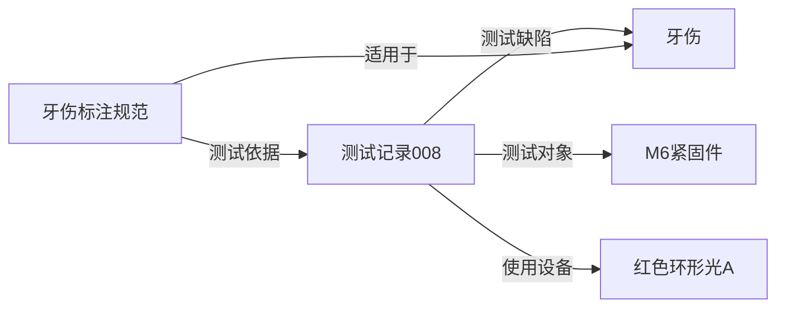

# AOI DATAS · 岳一科技数据资产中枢

> 以项目串联检测资料，让每一张图片有出处、每一个缺陷可追溯、每一次售后经验可复用。

当前应用版本：**1.9.1**，版本及代码更新时间以 [version.json](version.json) 和网页左下角显示为准。

本项目将项目、产品、检测工程、图片、缺陷、技术协议和售后经验关联管理，支持公司内网共享、模型测试记录、本地模型离线分割，以及基于知识库的 AI 问答。

第一次了解知识图谱，可先阅读[知识图谱入门与录入规范](#知识图谱入门与录入规范)，包含三元组、与现有表的关系以及工业检测资料的录入示例。

## 平台建设初衷

把分散的工业检测资料，沉淀为公司可复用的知识资产。平台按产品、缺陷和项目关联图片、检测工程、测试结果与售后经验，让资料查得快、经验传得下，也为后续 AI 应用积累可靠依据。

准确、一致、具有代表性且可追溯的数据，是工业 AI 可靠应用的重要基础。首页以“资料有出处、标准说得清、结论有依据、经验可复用”介绍建设目标，并用紧固件牙伤案例说明：复用经验前，需要核对产品、缺陷定义、模型版本、成像条件和测试依据。已有资料规模、工作提醒和日常操作继续保留在首页工作台。

## 功能概览

| 模块 | 当前功能 |
| --- | --- |
| 资料库总览 | 建设初衷与业务价值、知识积累路径，以及项目/工程/图片统计、工作提醒和最近资料 |
| 数据录入与维护 | 项目、产品、分类、材质、工艺、缺陷、工程、协议、视频和售后经验 |
| 紧固件目录 | 外部分类树、BN 系列与公开属性检索；管理员审核 Excel、预览差异后补充更新 |
| 图片资料 | 上传命名、已有图片重命名、缩略图、原图预览、多工程关联、多缺陷批量绑定 |
| 视频资料 | 项目视频与通用经验视频统一入主表，封面、播放、拖动及下载 |
| 文档类型资料 | 通用或项目文档、可复用文档类别、Word/PPT/PDF 首页自动封面与旧文档补生成 |
| 操作规范与技术经验 | 适用产品/分类/材质/工艺/缺陷、设备、条件、确认状态、范围匹配的测试依据与证据定位 |
| 知识关联 | 双向关系、分类层级、材质与工艺、名称归一和同名歧义处理；另保留表结构图 |
| 资料检索 | 沿用原布局，检索图片、文档、视频、工程及其他资料 |
| 售后经验 | 关联项目与产品，记录现象、原因、方案与经验，支持 CSV/XLSX 预览导入 |
| 软件测试记录 | 按自定义模块保存测试步骤、预期结果、实际测量数据、设备条件和效果图 |
| 大模型离线测试 | 选择本机检查点、批量排队、逐图分割、原图叠加、阈值调整和结果保存 |
| AI 智能问答助手 | 本地检索、适用范围筛选、DeepSeek 流式回答、停止生成、来源引用、私人历史和反馈 |
| 账号与维护 | 录入员/管理员、批量账号、作者记录、编辑冲突检查和操作审计 |

“使用指南”已替换为“AI智能问答助手”；MySQL SQL 栏目不再显示在导航中，但 MySQL 运行支持保留，SQL 导出接口仅管理员可用。

## 1.9.1：更正材质、工艺与删除字典

- 在“数据录入”选择材质字典或工艺字典，点击“详情与关联”，可直接编辑该条目、更正产品材质或工艺绑定，管理员还能逐条解除错误的材质/工艺绑定。关联未处理完时会显示剩余引用数量；处理完后可在同一窗口删除字典条目。
- 仅名称录错时，直接编辑字典名称即可，已有产品关联继续保留。产品选错材质或工艺时，优先用“更正产品材质”或“更正工艺绑定”选择正确条目；确实不需要时再解除，产品材质变为空。解除工艺只移除当前产品的这一条工艺关系，不删除产品或其他工艺。
- 删除受引用保护时，页面会列出产品与知识关联数量，并打开可操作的关联详情。删除与解除绑定仍限管理员；访客只读，录入员可编辑记录。
- 解除绑定会校验当前关联和更新时间，其他人已经修改的绑定不能按旧页面清除。涉及已验证经验的测试依据时会重新校验范围；不匹配则回滚，需先核实相关经验的适用范围。产品、图片、工程、测试记录和原文件不会随字典清理而删除。

更新代码后重启服务并刷新页面，左下角应显示1.9.1。数据库表结构保持兼容，无需手动修改数据文件。

## 1.9 更新说明

- 新增独立的“紧固件目录”，保存来源分类层级、一个系列的多个分类、BN 编号、头型、驱动槽型、螺纹、材质、材料类型、制造材料、性能等级、表面处理、颜色和标准。每条记录保留来源 URL、采集时间和原始属性；公开页未提供的值留空。
- Bossard 的 BN 通常代表**产品系列**，不能直接当作某个尺寸的客户产品。外部目录与原有 `products`、`product_categories` 分开保存，不自动合并为公司产品或测试对象。
- Excel 中所有新采集记录默认“待审核”。管理员将审核通过的记录改为“是”，在目录页先“预览校验”，再“确认更新目录”。重复来源编号匹配已有记录，只补空值和缺少的分类关联，保留已有冲突值，不执行删除。
- 提供可选的公开页面采集脚本 `bossard_catalog.py`，网页正常运行和 Excel 导入无需安装浏览器采集依赖。脚本遵守 robots、限速并保留检查报告；访问限制、动态分页或缺失字段都不能作为已完整采集的证明。
- 本地采集工具包支持下载详情页主产品照片，保存原始文件与 PNG，在审核 Excel 中增加“产品图片”、本地路径、来源和状态。支持仅给已有产品补图、断点续采与离线重新导出，附 Windows 运行入口、JSON 配置、代码注释及[配置与原理教程](BOSSARD_COLLECTOR_GUIDE.md)、[接口定义](BOSSARD_COLLECTOR_API.md)。[下载工具包和审核文件](review_exports/bossard/2026-11-11/README.md)。图片目前辅助审核，不会由 Excel 自动导入业务图片库。

分类规则、Excel 审核方法、本地采集命令及边界见 [CATALOG_IMPORT.md](CATALOG_IMPORT.md)。仓库附有391个系列的审核快照和续采缓存，另有317个BN待采，尚未完成全站采集；应审核实际交付工作簿的“采集报告”，当前样本也不代表完整实时目录。升级启动会创建三张独立目录表，**不会自动把待审核 Excel 写入业务库**。

## 1.8 更新说明

- 文档封面自动使用 **Word 第一页、PPT 第一张幻灯片、PDF 首页**，支持 DOC/DOCX、PPT/PPTX、ODT/ODP 等格式。Office 文件先经本机 LibreOffice 转成临时 PDF，再渲染首页；原文档不变。自定义封面优先保留。
- 服务启动后会在后台给已导入的本地文档补生成封面；浏览资料时也会按需生成。封面缓存随文件内容时间戳更新；旧版文字占位缓存不再沿用。NAS 路径、压缩包成员及原文件缺失的记录会跳过。
- **运行网页服务的电脑需安装 LibreOffice**（Windows / macOS / Linux）。常见安装路径会自动识别；其他路径用环境变量 `AOI_SOFFICE` 指向 `soffice.exe` 或 `soffice`。PDF 依赖 PyMuPDF，已加入 `requirements.txt` 和启动依赖检查。Docker 镜像已包含 Office 转换工具和中文字体。
- AI 问答通过真实的流式接口边生成边显示，提供“停止回答”。检索进度及来源先显示；中断会明确提示，半截文字不会作为完整模型回答保存。原 JSON 问答接口继续兼容。
- 知识关联补齐产品材质、工艺和分类上下级。名称和别名支持全角半角、大小写与空白归一；同名多对象会要求补充规格或版本，不自动合并。
- “已验证”关系会检查依据测试是否覆盖适用产品、缺陷、材质、工艺或设备。问答排除已明确冲突的产品和模型版本等条件；未登记的条件仍按未知处理，不把空白当作匹配证明。自由文本条件继续保留，尚不支持自动理解所有自然语言条件。
- 逐条关联可补充依据文档和“页码 / 表格 / 视频时间点”，并随来源提供给问答。旧记录不会自动改成已验证。
- 字段长度、数值范围和单位统一维护在 `schema.py`，生成 MySQL DDL 与 JSON Schema；`python export_contract.py --check` 检查生成文件一致性。新增 SQLite / MySQL 字段采用增量升级，保留原 ID 和附件。

更新前备份业务数据，安装新版依赖并重启服务：

```bash
python -m pip install -r requirements.txt
python app.py --no-browser
```

也可在使用相同 `AOI_DATA` 的环境中手动补生成封面、检查旧知识：

```bash
python backfill_previews.py
python verify_knowledge.py
```

封面生成失败时保留原文件下载，安装缺失工具或修复文档后会重试。HTTP 反向代理应对 `/api/assistant/chat-stream` 关闭缓冲（Nginx：`proxy_buffering off;`）并允许至少 120 秒的读取等待；应用同时发送 `X-Accel-Buffering: no`。

## 快速启动

### 环境要求

- 网页服务：Python **3.10+**，建议使用独立虚拟环境。
- 默认数据库：SQLite，无需另外安装数据库服务。
- 内网共享：将服务运行在同事能访问的公司电脑或服务器上。
- 离线模型：另需具备完整模型工程、权重及匹配的 PyTorch 环境；网页依赖安装不等于模型环境已准备完成。
- AI 生成回答：需配置可用的 DeepSeek API 密钥；未配置时仍可检索本地资料。
- Word / PPT 首页封面：服务器安装 [LibreOffice](https://www.libreoffice.org/download/download-libreoffice/)。PDF 使用 PyMuPDF；视频首帧使用 ffmpeg。Docker 镜像构建已配置这些依赖。

### Windows 首次安装

以下命令在项目目录的 **CMD** 中执行。虚拟环境和业务数据建议放在代码目录之外，避免更新代码时覆盖数据。

```bat
python -m venv ..\yueyi-venv
..\yueyi-venv\Scripts\python.exe -m pip install -r requirements.txt

set "AOI_DATA=D:\YueyiData"
..\yueyi-venv\Scripts\python.exe manage_users.py
..\yueyi-venv\Scripts\python.exe app.py --no-browser
```

请将 `D:\YueyiData` 换成实际数据目录。`manage_users.py` 按提示创建首个管理员，密码至少 12 位且输入不回显；没有默认管理员或公共密码。如果已经存在管理员，使用现有账号登录。

浏览器打开 `http://127.0.0.1:8765`。随后可在“账号管理”创建录入员、管理员或重置密码。

`AOI_DATA` 必须在管理员初始化、网页启动、离线配置及账号批量创建时保持一致。未设置时，默认使用项目目录下的 `data`。

### 使用启动脚本

| 系统 | 仅本机访问 | 公司内网访问 |
| --- | --- | --- |
| Windows | `start.bat` | `start-lan.bat` |
| Linux | `sh start.sh` | `sh start-lan.sh` |

启动脚本会检查部分运行依赖。Windows 脚本优先使用 `py -3`；使用独立虚拟环境时，建议像上例那样直接调用该环境的 Python，确保解释器和依赖一致。

### 公司内网访问

使用与安装、初始化相同的环境和数据目录运行：

```bat
..\yueyi-venv\Scripts\python.exe app.py --no-browser --host 0.0.0.0 --port 8765
```

同事访问 `http://服务器内网IP:8765`。由 IT 设置固定 IP 或内网 DNS，并将 TCP 8765 的访问限制在公司网段。

正式共享建议配置 HTTPS 反向代理，保留原始 Host，让应用监听 `127.0.0.1`，并设置 `AOI_SECURE_COOKIE=1`。该选项只适用于通过 HTTPS 访问；普通 HTTP 不会加密密码和会话。云环境不会自动接入公司内网。

## 账号、权限和作者信息

| 操作 | 访客 | 录入员 | 管理员 |
| --- | --- | --- | --- |
| 浏览业务资料、检索、下载 | ✓ | ✓ | ✓ |
| 新增、编辑、上传、重命名 | — | ✓ | ✓ |
| 删除、解除工程关联 | — | — | ✓ |
| 售后批量导入、问答知识导入及手动更新索引 | — | — | ✓ |
| 紧固件目录写入、审核导入 | — | — | ✓ |
| AI 问答及个人历史 | — | 仅本人 | 仅本人 |
| 离线测试任务 | — | 本人任务 | 全部任务 |
| 账号管理、操作审计、SQL 导出 | — | — | ✓ |

- 每条业务记录自动保存录入作者、录入时间、最后修改人和时间，不能在表单或导入文件中冒填作者。历史记录没有作者时保持未知。
- 多人编辑采用最后修改时间校验，过期表单会提示刷新，避免覆盖他人修改。
- 管理员重置密码会注销该账号已有会话；登录会话有效期为 8 小时。
- 管理员可一键创建 **50 个独立随机密码**的录入账号并下载密码清单，也可在服务端执行：

```bat
..\yueyi-venv\Scripts\python.exe provision_accounts.py --count 50 --output D:\Private\accounts.csv
```

请先准备输出目录。密码清单必须位于仓库之外，不能提交 Git。已有同名前缀账号会跳过并继续编号，不覆盖旧账号。每人使用独立账号，才能准确记录作者。

## 核心业务使用

### 紧固件目录

从侧栏或首页进入“紧固件目录”，按来源分类（包含下级）、BN、名称或属性检索。访客和录入员可浏览；管理员可在“导入已审核 Excel”中先预览新增、补充、跳过、冲突和错误，再确认更新。文件修改、预览过期或目录数据发生变化后需重新预览。

审核时保留来源编号，不按产品名称去重。将“分类候选（待确认）”核实后填写到“分类编号”，多个分类用 `|` 分隔；候选列本身不会建立关联。材质、材料类型、制造材料分别保存，表面处理名称也不会自动转成颜色。完整流程见 [CATALOG_IMPORT.md](CATALOG_IMPORT.md)。

### 图片与缺陷

- 上传时只填写图片主名称，扩展名自动保留；已有本地图片可重命名，文件名与数据库路径同步更新。
- 图片库、图片表格和检索结果按“**未绑定逐图缺陷优先，同组最新录入优先**”排序。最新按递增图片 ID 判断，不代表最近修改时间。
- “图片—缺陷”新增记录可一次选择多个缺陷；图片库支持多图批量绑定，已有关系自动去重。
- 包级缺陷仅作参考，不会自动传播为每张图片的缺陷。未绑定缺陷不等于 OK。
- 一张图片可绑定多个检测工程版本。NAS 登记、压缩包成员或原文件缺失的记录不能按本地文件方式重命名或预览。

### 检测工程与首页图片总数

工程登记本地文件或文件夹的完整路径，可手动填写“工程图片数量”，通过“编辑”或“修改图片数量”补录。

数量必须为非负整数：**0 表示确认没有图片，空白表示未知**。首页图片总数按各工程手填数量汇总，未填写工程单独提示；实际登记图片数另外显示，不与工程数量相加。同一图片位于多个工程时，按各工程填报数量计入，不能将其理解为去重文件数。

软件名称、软件版本已从工程编辑界面隐藏，旧字段保留兼容。Windows 本机可定位工程目录；远程访问者不能通过按钮打开自己电脑上的目录。

### 视频资料与文档类型资料

- **项目视频绑定项目，通用经验视频可不绑定项目**。在视频资料新增窗口选择项目并上传，单文件最多 **1 GB**；推荐 H.264 MP4，其他格式能否播放取决于浏览器编码支持。
- **文档类型资料直接在“新增记录”上传**：填写文档类型、项目、编号、名称并选择本地文件，一次保存记录和附件。首次保存失败会回滚；编辑已有协议可追加附件，单文件最多 **256 MB**。
- 文档可独立保存，不强制项目；文档类别可在录入窗口新增或在配置表维护，后续上传下拉复用。PDF、TXT、MD、CSV 可在预览窗口查看，其他格式查看封面并下载；不自动解析到知识正文。通过“文档—产品”可以关联多个产品。
- 旧视频只能在项目关系唯一时自动补填项目，否则需手动编辑选择。旧文件及记录 ID 保留。

### 软件测试记录

这是人工测试档案，**不会调用模型**。支持“大模型测试、AI检测稳定性测试、AI运行时间测试、算法重复误差测试”及自定义模块，可按模块筛选。填写测试方法与步骤、预期结果、实际结果与测量数据；运行耗时及重复误差等结果可连同单位记录在实际结果中。模型 / 软件 / 算法名称必填，其他指标按模块需要填写。旧测试自动归为“大模型测试”，旧技术协议自动归为文档类型“技术协议”。表单采用统一标签在上、输入框在下的布局，窄屏自动单列。

记录模型名称、版本、关联产品、测试产品总数、检出率、良率及测试环境备注，分别上传原图和效果图。新增、编辑时还可填写光源类型、相机型号、镜头型号、工作距离（mm）和产品规格；记录卡片直接显示，搜索也支持这些条件。工作距离可留空，填写时须为非负数，支持小数。这些字段记录本次测试条件，旧记录不会被自动猜测或覆盖，可后续补填。

图片支持多选、拖拽和粘贴截图，单击放大，下载使用独立链接。登录账号可重命名；管理员可删除单张图片，原文件移至数据目录的 `trash/model_tests` 回收区。

检出率、良率按 0–100 的百分数手动填写，不互相推算。旧漏检率和项目关联保留为历史字段，不当作良率或自动映射为产品。测试图片不计入正式检测图片统计。

### 操作规范与技术经验

在侧栏或数据录入主表中进入“操作规范与技术经验”，填写标题、分类、关键词与正文，无需项目或产品。适合记录规范标注、AI 原理解释、工具操作步骤等通用技能。正文和备注各支持最多 20000 字。

保存后可上传多个文档或视频，也可关联已有文档、项目视频。新上传及旧版技术经验附件会进入文档/视频主表，主表记录与经验引用同一份原文件。解除经验关联或删除经验会保留主表资料。可上传封面；自动尝试视频首帧、PDF 首页与 Office 文档首页预览；Office 需 LibreOffice，视频需 ffmpeg，不具备转换工具时使用资料名称封面，仍可上传自定义封面。文档单文件最多 256 MB，视频最多 1 GB；视频可直接播放及拖动，实际编码支持取决于浏览器。管理员可解除资料关联或删除经验，附件原文件保留。

标题、分类、关键词、正文、备注、条件、确认状态及关联资料名称自动进入智能问答，下次提问同步新增、编辑和删除，参考来源显示“操作规范与技术经验”。附件不自动解析，视频不自动转写；需要被问答使用的操作要点请写入正文。

## 知识图谱入门与录入规范

### 知识图谱是什么

可以把知识图谱理解成一张“谁和谁有什么关系”的知识地图。资料库保存产品、图片、报告和经验；把这些对象之间的关系明确登记后，就能沿着关系查找相关资料。例如，看到“牙伤”，可以找到对应图片、做过的测试、适用的标注规范，以及支撑经验的测试记录。

知识图谱的三个基本组成是：

| 组成 | 通俗理解 | 本系统中的例子 |
| --- | --- | --- |
| 实体 | 能够单独识别的一个对象 | 某个产品规格、某种缺陷、某次测试、一条经验 |
| 关系 | 两个对象之间明确登记的联系 | 测试对象、测试缺陷、适用于、使用设备、测试依据 |
| 属性 | 描述对象或关系的具体信息 | 型号、版本、测试日期、检出率、适用条件、确认状态 |

关系图是浏览这些知识的一种方式。图中对象和关系背后的业务记录、原始资料及适用条件，才是查询与问答的依据。

### 三元组是什么意思

三元组就是用“主体、关系、客体”表达一条事实，通常写成 **（主体，关系，客体）**。例如：

| 主体 | 关系 | 客体 |
| --- | --- | --- |
| 测试记录008 | 测试对象 | M6紧固件 |
| 测试记录008 | 测试缺陷 | 牙伤 |
| 测试记录008 | 使用设备 | 红色环形光A |
| 牙伤标注规范 | 适用于 | 牙伤 |
| 牙伤标注规范 | 测试依据 | 测试记录008 |

每一行是一条独立事实，共用的对象把多条事实连接成图。具体值也可以作为客体理解，例如“（测试记录008，检出率，98%）”。本系统实际把检出率保存在测试表字段中，把跨对象的业务关系保存在外键或关联表中，关系还可以附带条件、状态和测试依据。

把上面的关系连起来，可以这样理解：



**结果应归属于具体测试。**“测试记录008的检出率为98%”保留了继续查找日期、版本、样本与设备条件的入口。直接写成“模型A的检出率为98%”，容易丢失结果成立的条件。

### 与现有表、数据库和表结构图的关系

关系数据库和知识图谱可以表达相同的事实，区别主要在组织和使用信息的侧重点。

| 对比 | 关系表的表达方式 | 知识图谱的表达方式 |
| --- | --- | --- |
| 描述一个对象 | 一行集中保存同类对象的属性 | 一个实体附带属性 |
| 表达对象联系 | 外键、关联表及查询连接 | 有明确含义的关系 |
| 查找关联资料 | 按字段及关联条件查询 | 沿实体之间的关系查找 |

例如，测试表一行中的“产品=M6紧固件、光源=红色环形光、检出率=98%”，可以拆开理解成多条事实。已有“图片—缺陷”关联也可以直接理解为“某张图片展示某种缺陷”。因此，采用知识图谱思路不要求把所有表改成通用三元组表，也不要求先更换成专门的图数据库。

本工程继续使用 SQLite / MySQL，通过以下结构组织知识：

| 现有结构 | 在知识组织中的作用 |
| --- | --- |
| 产品、分类、缺陷、测试、经验、文档、视频等业务表 | 提供实体身份和属性 |
| 项目—产品、图片—缺陷、文档附件等外键和关联表 | 提供已经明确保存的业务联系 |
| `technical_objects` | 统一设备、工具、软件和模型的名称、型号及版本 |
| `entity_aliases` | 保存人工确认的别名，帮助用不同叫法找到同一个对象 |
| `knowledge_links` | 保存适用、测试、使用和依据等关系，以及条件、状态和证据 |

“表结构图”说明有哪些表、字段和外键；“知识关联”说明哪个具体产品、缺陷、测试和经验彼此有关。两种视图可以一起使用。

系统当前侧重工业检测技术资产与知识管理：保存检测资料、测试过程和可复用经验。知识关联让这些记录能够相互查找；原来的项目管理、资料上传、测试档案和售后记录继续保留。

### 当前系统如何使用这些关系

- 技术经验填写经验类型、适用条件、确认状态，并搜索多选已有产品、分类、缺陷、设备与测试依据；未知留空。设备或缺陷等字典可在选择时新建，已保存的测试与经验从相应业务模块录入后关联。
- 软件测试记录填写测试缺陷范围、检测面、判定标准、设备/软件/模型与参考规范。保存时冻结设备及模型参数快照，设备字典更新不会修改历史快照；确实需要修改时明确勾选“更新本次参数快照”。
- 关联支持逐条登记条件、状态与测试依据；“已验证”的经验要求选择测试依据。引用对象必须存在，删除被知识关联引用的对象会提示先解除关系。新增、编辑和关联变更在同一事务保存，并检查编辑冲突。
- “知识关联”展示真实业务记录；点击“详情与关联”可双向查看产品、缺陷、测试、经验、文档和视频。详情支持人工添加别名，别名不会自动合并对象。原数据库结构图通过“查看表结构图”进入。
- AI 问答同时使用文字索引与数据库明确登记的关系。匹配名称/别名后，最多查询两层关联，再附带条件、状态及测试结果作为依据；不会从共现关系自动推断因果或普遍适用性。

录入人员使用业务表单选择对象、填写内容，系统负责保存对应的实体属性和关系，无需手工填写“主体、关系、客体”三列。

### 后续录入数据需要注意什么

1. **先搜索已有对象，再决定是否新建。**选择时核对编号、规格、型号和版本。名称相近可能是不同产品，同名也可能对应不同规格。
2. **确认同一对象后再添加别名。**例如“牙伤”和“牙部损伤”是否为同一种缺陷，需要人工确认；别名用于查找，不会自动合并记录。
3. **重要关系通过选择框登记。**正文解释操作步骤和原因；适用哪个缺陷、使用哪个设备、由哪次测试支持，应同时建立明确关联。
4. **测试结果保留样本和条件。**记录测试日期、数量、缺陷范围、判定标准、版本、设备及参数。某次测试的结果不能直接推广到所有产品、版本和成像条件。
5. **区分观察、建议与验证结论。**“这次使用了某光源”表示使用事实；“推荐使用该光源”还需要说明适用条件和依据。被关联、被搜索到或被 AI 引用，都不自动表示结论已被验证。
6. **状态按实际情况填写。**待补充表示资料尚未完整；待验证表示结论仍需测试；经验建议应保留经验适用范围；已验证需要关联相应测试依据，并说明验证范围。
7. **未知就留空或标记待补充。**未填写、没有观察到、确认不存在是不同情况。旧资料缺少设备、条件或关联时，不按名称相似或个人猜测自动补齐。
8. **把关键知识写进正文并保留原始依据。**文档、图片和视频可以关联作证据，但封面和预览不代表内容已经进入问答知识库。希望 AI 使用的步骤、限制和结论，需要写入经验正文。

### 一个完整录入例子

以“牙伤标注规范”为例，可以按以下顺序整理资料：

| 步骤 | 录入内容 |
| --- | --- |
| 确认对象 | 搜索并选择已有“牙伤”和实际适用的产品规格；缺少对象时先核对再新建 |
| 登记测试 | 保存本次测试的模型版本、设备、样本范围、判定标准、实际结果和测试图片 |
| 录入经验 | 标题填写“牙伤标注规范”，类型选择标注规范，正文写清标注边界与复核步骤 |
| 明确范围 | 在适用条件中说明产品、检测面、成像条件及限制；通用经验可以不绑定项目 |
| 建立关系 | 选择相关缺陷、适用产品、涉及工具及参考测试；按实际情况填写确认状态 |
| 保留资料 | 关联说明文档、示例图片或演示视频，必要时设置封面 |
| 检查关联 | 从缺陷、产品或测试的“详情与关联”反向查看，确认关系登记正确 |

之后查询“牙伤有哪些测试和规范”，系统就能结合明确登记的关系与经验正文寻找依据。问答仍受已录入资料和当前查询范围限制；知识关联本身不会执行检测模型，也不会自动证明检测效果。

## 分类归档与文件名称

上传文件按资源类型分开保存在 `uploads/images`、`uploads/videos`、`uploads/documents`、`uploads/engineering`、`uploads/archives` 或 `uploads/other`。每条资源使用独立编号目录，文件名采用数据库中的名称并保留实际扩展名，同名资料不会互相覆盖。Windows 不允许的文件名字符会替换为下划线。

编辑文档标题、视频名称或重命名图片后，文件名与数据库路径同步调整。文档的多个附件保留各自扩展名与独立目录。旧版平铺上传文件在启动升级时整理，同时更新已有链接；缺失原文件和 NAS/压缩包成员不会被伪造或搬移。归档失败时回滚本次数据库和文件移动。

升级前停服并备份实际 `AOI_DATA`，更新全部代码后重启并按 Ctrl+F5 刷新。SQLite 升级、旧附件进入主表及重复启动已测试；MySQL DDL 与迁移代码保留，实际 MySQL 服务升级仍需在目标环境验证。

## AI 智能问答与知识库

### 配置 DeepSeek

在**运行网页服务的电脑**配置环境变量后重启服务：

| 环境变量 | 用途 |
| --- | --- |
| `AOI_RAG_API_KEY` | 你的 DeepSeek API 密钥，服务端安全保存 |
| `AOI_RAG_BASE_URL` | 默认 `https://api.deepseek.com` |
| `AOI_RAG_MODEL` | 默认 `deepseek-chat` |

不要把密钥写入源代码、批处理文件或上传的表格，也不要提交到 Git。公司网络需要允许访问 `api.deepseek.com`；云端配置的密钥不会自动同步到本机。

未配置密钥时，界面明确展示本地知识原文检索；模型调用失败时保留参考来源并提示失败，不伪装成 AI 回答。没有依据时会提示资料不足。外部生成会发送当前问题、命中的知识摘录和当前私人对话的有限上下文，DeepSeek API 按其服务规则计费。

### 两种资料导入方式

| 入口 | 适用资料 | 关联要求 |
| --- | --- | --- |
| AI 助手 → 知识库管理 → 导入问答知识 | 现有问答 CSV/XLSX，如“问题类型、问题描述、解决方案” | 不要求项目与产品 |
| 数据录入 → 售后经验 → 导入售后 CSV / Excel | 需要作为业务记录维护的售后案例 | 必须关联项目与产品，可指定默认值 |

售后导入先预览，校验每行内容、日期、项目和产品，跳过完全重复的记录；有错误时整批不写入。支持 UTF-8/BOM、GB18030 CSV 及 XLSX 第一张表，单文件最多 **5 MB、5000 行**。可下载英文列名模板，也可使用支持的中文表头。

**已解决且有处理方案或经验**的售后记录会进入本地知识库。新增、修改、删除后，下次提问会自动同步；管理员也可手动更新索引。长文本分段保留，问答附参考来源；反馈与模型回答不会自动成为新知识。

对话历史按账号隔离，管理员也不能通过问答接口查看他人私人对话。开发环境里导入的知识内容不会随 GitHub 代码部署，请在本机导入自己的原始资料。

详细配置、知识库维护和限制见 [RAG_ASSISTANT.md](RAG_ASSISTANT.md)。

## 本地大模型离线测试

该模块实际调用**服务器本地模型**，与人工“软件测试记录”和 DeepSeek 文本问答相互独立。

1. 在运行服务的电脑准备完整模型工程、基础权重及训练检查点。
2. 模型 Python 环境安装匹配的 PyTorch/torchvision 和工程依赖，可参考 [requirements-offline.txt](requirements-offline.txt)。
3. 使用相同 `AOI_DATA` 执行 `python configure_offline.py`，生成本地模型配置。
4. 网页进入“大模型离线测试”，选择模型、上传图片并查看队列和逐图结果。

默认配置对应当前工程路径：

| 项目 | 路径 |
| --- | --- |
| 模型 Python | `C:/ProgramData/anaconda3/python.exe` |
| 模型工程 | `F:/Fighting!!!!!!!!!!/MyDinoFiuntune` |
| 检查点目录 | `F:/Fighting!!!!!!!!!!/MyDinoFiuntune/checkpoints` |
| DINOv3 基础权重 | `F:/Fighting!!!!!!!!!!/UniADet-main/dinov3/model.safetensors` |

路径与实际电脑不一致时，通过配置命令参数修改。模型在服务器执行，云端无法直接读取你本机 F 盘。

支持每批最多 **200 张/512 MB**，单张最多 **32 MB/2000 万像素**。按批次排队，同批模型只加载一次，每完成一张即可查看该张结果。可以调整原始分割阈值、最小瑕疵面积、平滑强度、透明度及可选图像门限，在原图上显示瑕疵；结果生成后可直接重分割，无需重跑模型。

检查点安全加载失败时，使用 [convert_checkpoint.py](convert_checkpoint.py) 生成新的纯权重文件：

```bat
"C:\ProgramData\anaconda3\python.exe" convert_checkpoint.py "F:\Fighting!!!!!!!!!!\MyDinoFiuntune\checkpoints\uniadet_best_yashang.pt"
```

如果仍失败，**仅对你自己训练或完全可信的文件**添加 `--trust-source`。该选项只用于本机转换，不用于网页加载；转换结果为 `.safe.pt`，不覆盖源文件，网页需改选新模型并重新提交任务。

队列、接口及后处理已用测试专用进程验证；真实权重加载、检测精度和设备速度需要在实际模型环境验证。当前 MemoryBank 融合未接入。完整说明见 [OFFLINE_TESTING.md](OFFLINE_TESTING.md)。

## 数据位置、备份与升级

当前有 **34 张业务表**，其中三张用于外部紧固件目录；账号、会话、审计及问答内部存储不计入此数量。

实际数据目录由 `AOI_DATA` 决定，未设置时为项目下的 `data`：

```text
实际数据目录/
├── aoi.db                    # SQLite 业务数据、账号和会话（MySQL 模式另行备份业务库）
├── uploads/                  # images / videos / documents 等分类目录
├── thumbnails/               # 缩略图
├── trash/model_tests/        # 被删除的模型测试图片回收区
├── offline_models.json       # 本机离线模型配置
├── offline_tests/            # 离线任务、原图、分数图、叠图和日志
└── rag/
    ├── knowledge_sources.json # 导入的问答原始知识条目
    ├── index.json             # 可重建检索索引
    ├── source_sync.json       # 知识源同步状态
    └── qa.sqlite3            # 私人问答历史及反馈
```

JSON/CSV/SQL 导出不包含原文件、账号和私人问答，**不能代替完整备份**。SQLite WAL 模式下，不要只复制正在运行的 `aoi.db`；可停服后复制整个实际数据目录。MySQL 模式还需单独备份 MySQL 数据库；问答库和文件仍在数据目录中。

升级步骤：

1. 停止原服务，备份数据库及整个实际数据目录。
2. 更新完整代码，保持 `AOI_DATA`、数据库配置和模型配置一致，不用仓库中的 `data` 覆盖现有业务数据。
3. 用网页环境重新安装 `requirements.txt`；新版本启动会执行增量迁移，MySQL 账号需有相应建表、修改表和索引权限。
4. 重启 `app.py` 或相应启动脚本，再按 **Ctrl+F5** 刷新浏览器。
5. 核对左下角版本与 [version.json](version.json)，并验证登录、上传和已有文件访问。

仅替换文件不会更新已运行的 Python 进程。`migration-v1.2.mysql.sql` 是历史迁移文件，不能代替当前版本全部迁移。

文件保存在**运行服务的电脑**，而不是每位访问者的电脑；登记的工程路径也属于服务器。旧元数据被删除时不一定清理磁盘原文件，不要依赖删除记录来释放所有存储空间。

## 并发与部署边界

已加入 SQLite WAL + FULL 持久化、短写事务排队、状态缓存、响应压缩、缩略图并发保护、分页接口和编辑冲突校验。现有部分前端关系检索仍使用全量快照，数据量持续增长时需要继续分页和服务端检索优化。

隔离测试在 1000 张图片记录、50 个账号下，100 并发读取及 80 读取 + 20 上传均无错误；这不是持续运行、真实浏览器、大视频或外部模型服务的性能保证。测试范围与复现方法见 [PERFORMANCE.md](PERFORMANCE.md)。

SQLite 建议放在服务器本地 SSD，不放在 NAS/SMB 共享盘。MySQL/Docker 的配置入口为 [compose.yaml](compose.yaml)、[setup_mysql.py](setup_mysql.py) 和 [Dockerfile](Dockerfile)；生产迁移及负载应另外验证。离线 GPU 队列按单服务进程设计；同时启动多个服务进程会各自创建队列。

## 开发与验证

安装开发依赖后执行完整检查；验证使用临时数据库和本地模拟模型，不会修改业务数据，也不调用付费模型接口：

```sh
python -m pip install -r requirements-dev.txt
python -m unittest discover -p 'test_*.py' -q
node test_assistant_ui.js
node test_image_search.js
node test_offline_ui.js
node test_catalog_ui.js
python export_contract.py --check
```

1.8.0 的验证覆盖多页 Word、PPT 和 PDF，确认只选首页；流式测试确认首段提前到达、会话隔离及中断处理。重现 Office 转换测试需安装 LibreOffice；相关测试依赖为 `requirements-dev.txt` 中的 python-docx 和 python-pptx。目录解析、Excel 校验和权限使用离线样例及临时数据库测试；这些检查不代表已完成 Bossard 实站全量采集。

GitHub Actions 会运行回归、Office 首页转换、生成契约一致性和前端打包一致性检查。MySQL 生产升级、真实 DeepSeek 服务及 Docker 镜像部署仍需在对应环境验证。


| 文件 | 作用 |
| --- | --- |
| `schema.py` / `schema.mysql.sql` / `schemas/catalog.schema.json` | 统一字段规则、单位 / 生成的 MySQL DDL 与 JSON Schema |
| `export_contract.py` | 从字段注册表生成契约，支持 `--check` 检查漂移 |
| `knowledge_contract.py` / `knowledge_graph.py` | 统一术语与关系范围、对象歧义处理、证据检查和条件筛选 |
| `dictionary_maintenance.py` | 材质/工艺引用检查、管理员逐条解除产品绑定与并发校验 |
| `media_preview.py` / `backfill_previews.py` | 文档首页与视频首帧封面 / 已有文档封面补生成 |
| `verify_knowledge.py` | 只读检查旧知识引用、已验证依据及同名对象 |
| `app.py` / `auth.py` | HTTP、业务、上传及账号权限 |
| `static/app.js` / `static/style.css` | 主页面与已合并的前端资源 |
| `static/offline.js` / `static/assistant.js` / `static/technical.js` / `static/knowledge.js` / `static/resources.js` | 离线测试、问答、技术经验、知识关联及统一资料检索源码 |
| `build_frontend.py` | 合并离线、问答脚本与样式 |
| `offline_queue.py` / `offline_runner.py` | 本地推理队列与模型适配器 |
| `rag_assistant.py` / `assistant_service.py` | 检索生成、历史、知识源同步 |
| `experience_import.py` | 售后和问答 CSV/XLSX 校验、查重 |
| `catalog_import.py` / `CATALOG_IMPORT.md` | 外部紧固件目录审核、差异预览及幂等导入 / 使用说明 |
| `bossard_catalog.py` / `bossard_images.py` | 可选的 Bossard 公开目录、主图采集与审核 Excel 生成 |
| `run_bossard_collector.py` / `tools/bossard_toolkit/` | 独立采集配置入口、参数模板与 Windows 启动文件 |
| `BOSSARD_COLLECTOR_GUIDE.md` / `BOSSARD_COLLECTOR_API.md` | 本地参数、采集原理与函数/数据接口定义 |
| `static/catalog.js` / `static/catalog.css` | 紧固件目录浏览、属性检索和管理员审核导入界面 |
| `version.json` | 当前应用版本、代码更新时间及变更摘要 |

修改离线、问答、技术经验或紧固件目录前端源码后，执行 `python build_frontend.py`。仅修改本文档不改变应用版本。

核心回归：

```sh
python test_app.py
node test_image_search.js
node test_offline_ui.js
node test_assistant_ui.js
node test_catalog_ui.js
python -m unittest -v test_offline test_offline_http test_checkpoint_conversion
python -m unittest -v test_experience_import test_rag_assistant test_assistant_http test_knowledge_http test_feature_migrations test_catalog_storage
python -m unittest -v test_catalog_import test_bossard_catalog test_bossard_images test_bossard_runtime test_dictionary_http
```

可选并发压测：`python test_concurrency.py`。测试使用隔离数据；模型和 API 测试主要使用可控测试进程或模拟传输，不代表已经验证真实模型精度、GPU 速度或 DeepSeek 服务连接。
